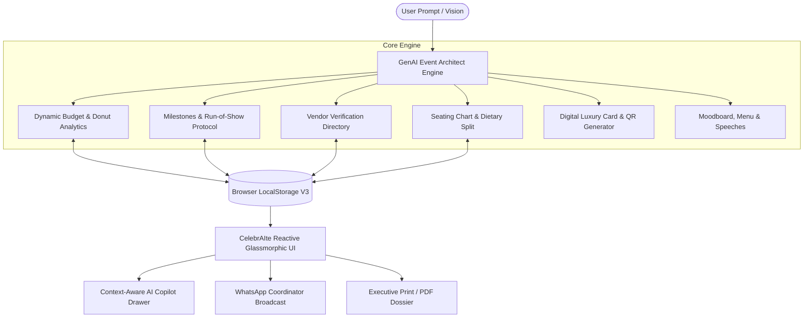

<div align="center">

# 🎪 CelebrAIte
### *Intelligent GenAI Celebration & Event Operating System*

[](https://opensource.org/licenses/MIT)
[](https://www.typescriptlang.org/)
[](https://tailwindcss.com/)
[](https://ai.google.dev/)
[](https://github.com/anuj-sharma7/CelebrAIte)

<p align="center">
  <b>Transform one-line prompts into complete, production-grade celebrations:</b><br/>
  Weddings, Milestone Birthdays, and Community Galas with automated budgets, run-of-show schedules, vendor verification checklists, live seating visualizers, and digital invitation QR suites.
</p>

[Quick Start](#-quick-start) • [Live Demo Highlights](#-key-features) • [System Architecture](#-system-architecture) • [Event Types](#-pre-configured-demo-events) • [Contributing](#-contributing)

---

</div>

## 💡 Why CelebrAIte?

Modern event coordination is broken. Organizers juggle chaotic spreadsheets, lost WhatsApp receipts, disconnected vendor quotes, and confusing seating charts.

**CelebrAIte** introduces a unified, reactive celebration operating system powered by GenAI:
- ⚡ **Instant Event Synthesis**: Input a single sentence (*"Plan a 3-day royal heritage wedding in Udaipur for 250 guests with ₹40 Lakhs budget"*), and CelebrAIte constructs the entire end-to-end plan in seconds.
- 🎯 **Grounded Financials & Run-of-Show**: Not just generic text, but structured category budgets with live donut analytics, hour-by-hour run-of-show timelines, contract verification gates, and visual seating pods.
- 🔒 **Zero Setup & Client-Side Privacy**: Runs completely in the browser with automatic LocalStorage sync. No servers, no mandatory dependencies, zero friction.

---

## 🌟 Key Features

### 1. 🤖 GenAI Event Architect
- **Smart Natural Language Synthesizer**: Parses budget, guest count, location, aesthetic, and ceremony requirements from plain English or Hinglish.
- **Auto-Balanced Budgeting**: Automatically calculates proportional splits across Venue, Catering, Decor, Cinematography, Entertainment, and Hospitality Buffers.
- **Multi-Phase Countdown Engine**: Generates 6-month milestones down to granular day-of execution steps.

### 2. 📊 Dynamic Budget & Expense Donut Analytics
- **Interactive SVG Donut Chart**: Hoverable, category-colorized visualization of expense allocation.
- **Cost-Per-Guest Metric**: Real-time per-attendee unit economics.
- **Deficit & Surplus Alerts**: Dynamic visual feedback when categories approach limits or overrun.
- **✨ AI Cost Reduction Advisor**: 1-click intelligent recommendations to shave 15-20% off total budget without compromising guest experience.
- **Quick Delta Micro-Adjustments**: Instant `+₹5,000` / `-₹5,000` invoice logging.

### 3. ⏱️ Master Timeline & Live Day-Of Command Center
- **Two-Tier Timeline**: Long-term milestones (Months & Weeks out) vs. Minute-by-Minute Run-of-Show.
- **🚨 Live Command Mode**: Real-time event day dashboard indicating what is **"Now Active"** and **"Next Up on Deck"**.
- **📲 1-Click WhatsApp Coordinator Dispatch**: Formats and copies the complete day-of schedule into your clipboard for immediate broadcast to volunteer and vendor team groups.
- **Celebratory Confetti Engine**: Triggers celebratory fireworks when phases or tasks are accomplished.

### 4. 👥 Vendor Hub & Quality Safety Verification Checklists
- **Directory by Domain**: Venue, Catering, Photography, Decor & Florist, Music & DJ, Logistics & Security.
- **Status Lifecycle Tracker**: `Researching` → `Contacted` → `Shortlisted` → `Booked & Locked` → `Fully Paid`.
- **Pre-Populated Verification Checklists**: Sound curfew permits, alcohol licenses, food tasting signoffs, power generator backups, and drone airspace clearances.
- **AI Contract & Negotiation Drafter**: Automatically drafts polite negotiation scripts and penalty clauses.

### 5. 💌 Digital Invitation Studio & Scannable QR RSVP
- **Luxury Royal Card Preview**: Custom monogram seals (`A & A`, `LVL 30`), gold-embossed filigree, and dress code banners.
- **Live Vector QR Code**: Standalone scannable QR code allowing guests to scan via phone camera for instant RSVP.
- **1-Click WhatsApp Broadcast Copy**: Generates formatted WhatsApp broadcast copy ready to send out in seconds.
- **Print / PDF Dossier**: Single-click printable executive summary.

### 6. 🪑 Visual Seating Layout & Table Visualizer
- **Interactive Table Pods**: Visual round & VIP head tables with capacity meters (e.g. `5 / 8 Seats`).
- **Dietary Breakdown Tracker**: Automatic catering tallies for **Veg**, **Non-Veg**, **Jain**, and **Vegan**.
- **Seat Allocation**: Filter seated guests by clicking any table pod or reassign seats in real-time.

### 7. 💡 Creative Suite & Audio Playlist Curator
- **Theme Moodboards**: Color palette swatches with aesthetic descriptions and styling guidelines.
- **Gourmet Menus & Molecular Cocktails**: Bespoke food & drink pairings.
- **Emcee Opening Speeches & Games**: Host icebreakers, Baraat antakshari, and trivia games.
- **Curated Audio Playlists**: Tracklist vibes for baraat entries, ambient dinners, and peak dance sets.

### 8. 🤖 Context-Aware AI Copilot Drawer
- Persistent floating assistant grounded in the currently active event.
- Knows your exact budget, spent totals, days remaining, vendor count, and guest dietary split.

---

## 🎪 Pre-Configured Demo Events

CelebrAIte comes pre-loaded with 3 rich, production-grade celebrations:

| Event | Category | Location | Budget | Highlights |
| :--- | :--- | :--- | :--- | :--- |
| **Arjun & Ananya’s Royal Heritage Wedding** | 💍 Wedding | Taj Lake Palace, Udaipur | ₹45,00,000 | 3-day royal palace, floating mandap, Mewari banquet, Manganiyar folk troupe |
| **Neon Cyberpunk 30th Milestone Birthday** | 🎂 Birthday | Indiranagar Penthouse, Bangalore | ₹1,80,000 | Liquid nitrogen bar, UV blacklight face painting, retro arcade tournament |
| **Silicon Valley Tech Innovation Hackathon & Fest** | 🎪 Community | BIEC Hall 4, Bangalore | ₹9,50,000 | 500 developers, 10Gbps fiber lease, 24/7 catering, stage AV, VC demo pitches |

---

## 🏗️ System Architecture



---

## 💻 Tech Stack

- **Frontend Core**: Vanilla Modern ES6+ / TypeScript / React 19 JSX Component Architecture
- **Styling**: Tailwind CSS + Custom Festive Glassmorphism & Gold Theme Design System
- **Typography**: Plus Jakarta Sans, Playfair Display Luxury Serif, Cinzel Monogram Serif
- **Visuals**: Pure Vector SVGs (Interactive Donut Charts, Table Pods, Scannable QR Codes)
- **Effects**: `canvas-confetti` fireworks engine
- **Persistence**: Reactive LocalStorage state machine with JSON Export/Import backup

---

## 🚀 Quick Start

### 1-Click Launch (No Node.js or Setup Required)
Simply double-click `index.html` or open in any modern browser:
```text
c:\Users\anujs\OneDrive\Desktop\celebration\index.html
```

### Running with Local Server (Optional)
```bash
# Clone the repository
git clone https://github.com/anuj-sharma7/CelebrAIte.git
cd CelebrAIte

# Serve with any static web server
npx serve .
# Or Python:
# python -m http.server 3000
```
Open your browser at `http://localhost:3000`.

---

## 📄 Export & Backup

- **JSON Backup**: Click **`JSON`** in the top navigation bar to download a portable snapshot of all your events, budgets, and guest lists.
- **Restore**: Easily import previous event plans using the JSON backup loader.
- **Executive Dossier**: Click **`📄 Dossier`** to view or print/save a clean PDF executive brief for clients or coordinators.

---

## 🤝 Contributing

Contributions, feature suggestions, and pull requests are warmly welcomed!
1. Fork the Project (`https://github.com/anuj-sharma7/CelebrAIte/fork`)
2. Create your Feature Branch (`git checkout -b feature/AmazingFeature`)
3. Commit your Changes (`git commit -m 'feat: Add some AmazingFeature'`)
4. Push to the Branch (`git push origin feature/AmazingFeature`)
5. Open a Pull Request

---

## 📜 License

Distributed under the MIT License. See `LICENSE` for more information.

<div align="center">
  <sub>Built with ❤️ by <a href="https://github.com/anuj-sharma7">Anuj Sharma</a> for modern celebratory experiences worldwide.</sub>
</div>
